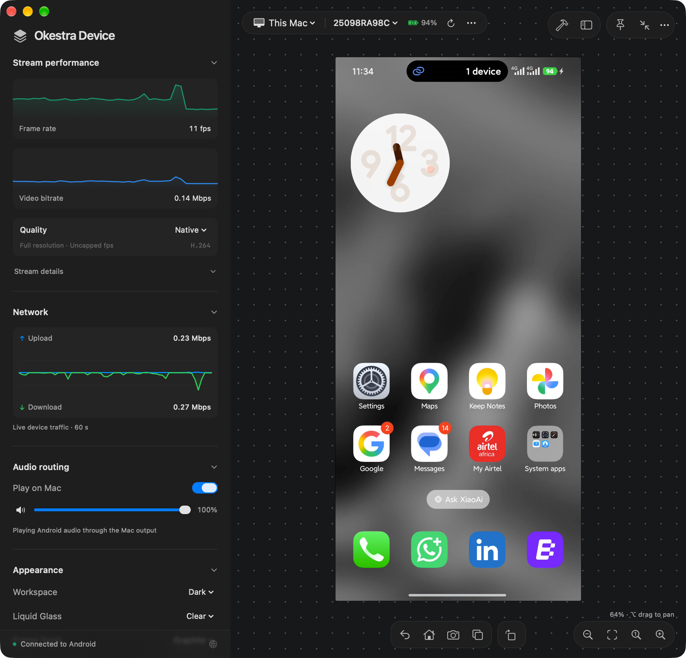

<div align="center">

# Okestra Device

### Your Android screen. Your Mac workspace.

View and control an Android phone from your Mac, or use an Android emulator running on your own Linux server.

**[Download for Mac](https://github.com/jonace-mpelule/okestra-device/releases/latest)** · **[Get started](#get-started-with-a-usb-phone)** · **[Wi-Fi setup](#connect-over-wi-fi)** · **[Need help?](#troubleshooting)**

**macOS 13+ · Apple Silicon & Intel · Android · Free & open source**



*A real Android phone connected to Okestra Device. Performance varies with your phone, connection, and quality setting.*

</div>

## What does it do?

| 📱 Work with your phone | 🎬 Capture and explain | 🛠 Inspect your app |
|---|---|---|
| Click, type, scroll, and use Android navigation from your Mac. | Take screenshots, annotate them, record video, and add review notes. | Install APKs, read logs, inspect network activity, and export diagnostics. |
| Connect by USB or pair over Wi-Fi. Play supported Android audio through the Mac. | Share recordings and annotated reviews with your team. | See live frame rate, video bitrate, and device traffic. |

**Start with the phone you already own.** A server is optional. This is a Mac app for Android devices; it does not mirror an iPhone or iPad.

## Choose your setup

| I want to… | What I need | Start here |
|---|---|---|
| Use an Android phone plugged into my Mac | A Mac, an Android phone, and a USB **data** cable | [USB setup below](#get-started-with-a-usb-phone) |
| Use my Android phone without a cable | A Mac and an Android 11+ phone on the same Wi-Fi network | [Wi-Fi setup](#connect-over-wi-fi) |
| Use an Android device without a physical phone | A Mac and an x86_64 Linux server that supports hardware virtualization | [Remote emulator setup](#optional-use-a-remote-android-emulator) |

## Get started with a USB phone

### 1. Download and install the Mac app

1. Open **[the latest release](https://github.com/jonace-mpelule/okestra-device/releases/latest)**.
2. Under **Assets**, download **`Okestra-Device-<version>.dmg`**. The same DMG works on Apple Silicon and Intel Macs. You do not need the “Source code” downloads.
3. Open the DMG and drag **Okestra Device** onto **Applications**.
4. Open **Applications → Okestra Device**.

> **If macOS blocks the first launch:** try opening the app once, then go to **System Settings → Privacy & Security → Open Anyway**, and confirm the system prompt. Current releases are not Apple-notarized. You do not need to disable Gatekeeper.

### 2. Install the Android connection tools once

Okestra Device needs Google's **Android platform-tools** to talk to your phone. The tool it uses is called **ADB**. These tools are separate from the Mac app.

If you already use Android Studio and its platform-tools are installed in the standard Mac SDK location, you can try step 3 first. Otherwise:

1. Press **⌘ Space**, type **Terminal**, and press **Return**.
2. Copy this entire block, paste it into Terminal, and press **Return**:

```sh
curl -fL https://raw.githubusercontent.com/jonace-mpelule/okestra-device/main/scripts/setup-android-mac.sh -o /tmp/okestra-device-setup.sh &&
sh /tmp/okestra-device-setup.sh
```

3. Read the Android SDK license link shown by the installer. To proceed, type **`y`** and press **Return** when asked.
4. Wait for **“Android tools installed”**. If the tools were already installed, the script prints the ADB version instead.
5. Quit and reopen Okestra Device.

This downloads the [setup script from this repository](scripts/setup-android-mac.sh), then runs it. The script downloads Google's tools, verifies the archive checksum, and installs them for your Mac user. Run it **without `sudo`**. You do not need Homebrew, Android Studio, Xcode, or a server for this setup.

### 3. Enable USB debugging on your phone

On your **Android phone**:

1. Open **Settings → About phone** and find **Build number**. Some manufacturers put it under **Software information**.
2. Tap **Build number seven times**. Enter your phone's PIN if asked.
3. Return to Settings and find **Developer options**. You can use the Settings search box; on many phones it is under **System**.
4. Turn on **USB debugging**.

Menu names vary by phone. [Google's official Developer options guide](https://developer.android.com/studio/debug/dev-options) explains where to find them.

### 4. Connect and choose your phone

1. Connect the phone to your Mac with a USB **data** cable. A charging-only cable will not work.
2. Unlock the phone. On the phone's **Allow USB debugging?** prompt, choose **Allow** for your Mac.
3. In Okestra Device, open the source menu above the canvas and select **This Mac**.
4. Click the **refresh arrow**, then choose your phone from the device dropdown beside **This Mac**. Its name may initially look like a serial number.
5. Selecting an authorized phone connects it. If needed, open the nearby **…** menu and select **Connect viewer**.

**You should now see your phone's live screen and “Connected to Android” in the sidebar.** Click or drag on the screen to interact with it.

```text
Android phone  ─── USB cable ───  Your Mac
                                  └─ Okestra Device → This Mac → your phone
```

## Find your way around

| Area | What you can do |
|---|---|
| **Top-left device bar** | Choose This Mac or a server, select a device, refresh, and open connection options. |
| **Main canvas** | View and control the phone. Use the navigation controls for Back, Home, Recent Apps, screenshots, and rotation. |
| **Left sidebar** | Watch stream performance and network traffic; adjust quality, audio, and appearance. |
| **Bottom-right zoom controls** | Zoom out, fit the screen to the window, view actual size, or zoom in. |
| **Hammer button / Developer menu** | Open device tools, including APK installation, logs, and capture tools. |
| **Okestra Device → Settings → Updates** | Control update checks and optional automatic download/install. |

Start with the default stream quality. If the picture stutters, try a lower quality setting before changing your setup. Audio playback requires Android 11+ and can depend on the device or app being captured. Protected content may appear black.

## Connect over Wi-Fi

Use an **Android 11 or newer** phone. Put the phone and Mac on the **same Wi-Fi network**, and install the Mac connection tools from [step 2](#2-install-the-android-connection-tools-once).

1. On the phone, enable **Developer options → Wireless debugging**.
2. In Okestra Device, select **This Mac**, open the **…** menu beside the device selector, and choose **Connect over Wi-Fi…**.
3. On the phone, tap **Pair device with pairing code**.
4. In the Mac's pairing form, enter the **pairing address and port** and **six-digit code** shown on that phone screen. Click **Pair**.
5. Return to the phone's main **Wireless debugging** screen. In the Mac form's connection step, enter the **connection address and port** from that screen and click **Connect phone**.
6. Close the form with **Done** once connected.

> The **pairing port** and **connection port** are different. Use the address from the correct phone screen for each step. If you have already paired this Mac, you can skip pairing and use the current connection address. Ports can change when Wi-Fi or wireless debugging restarts.

Guest Wi-Fi and networks that isolate devices can prevent this from working. [Google's wireless-debugging guide](https://developer.android.com/tools/adb#wireless-android11-commandline) explains Android's pairing requirements.

## Optional: use a remote Android emulator

An **emulator** is a virtual Android phone. This option runs Android on a Linux machine and streams it to your Mac. **Skip this section if you are using a physical phone.**

```text
Your Mac                              Your Linux server
Okestra Device ── private network ──► Device service ──► Android emulator
```

You need an **x86_64 Ubuntu/Debian server**, working **KVM hardware virtualization**, and a private network connection from your Mac. Many VPS plans do not provide KVM access; check with your host first. The server needs enough spare CPU and RAM for its emulator. The app lets you assign 1–8 cores and 1536–8192 MiB RAM to a saved device.

<details>
<summary><strong>Show the server setup steps</strong></summary>

### A. Install the server

On your Linux server, run:

```sh
uname -m
ls -l /dev/kvm
```

The first command should print `x86_64`. The second should show `/dev/kvm`. If it does not exist, enable virtualization or nested virtualization before proceeding.

1. From [the latest GitHub release](https://github.com/jonace-mpelule/okestra-device/releases/latest), download **`okestra-device-service_<version>_linux_amd64.tar.gz`**.
2. Transfer it to the server, using your usual SSH/SFTP tool. Put this single archive in a new, empty setup folder.
3. Open a terminal on the **server**, change into that folder, and run:

```sh
tar -xzf okestra-device-service_*_linux_amd64.tar.gz
sudo ./install-android.sh
```

4. When asked for the server address, enter its **private-network IP address with port 8089**; for example, `192.168.1.50:8089`. Replace this example with an address your Mac can reach.
5. Follow the Android SDK license prompts. The installer sets up the service, Android SDK, Java, and an initial emulator, and enables KVM access for the service account.
6. Save the **server URL and token** printed during installation. Keep the token private—it grants access to your emulator.

If you need to see the connection details again:

```sh
sudo ./install-service.sh --show-connection
```

Use a trusted private network or encrypted VPN, or configure HTTPS. Do not forward this service directly onto the public internet. Docker is not needed.

### B. Add that server on your Mac

1. From the same release, download the **Mac CLI archive** matching your Mac:

   | Mac | Download |
   |---|---|
   | Apple Silicon (M1, M2, M3, M4, or later) | `okestra-device_<version>_darwin_arm64.tar.gz` |
   | Intel | `okestra-device_<version>_darwin_amd64.tar.gz` |

   Find your chip under **Apple menu → About This Mac**.

2. In Finder, double-click the archive to extract it. Open Terminal, type `cd ` (including the space), drag the extracted folder into Terminal, and press Return.
3. Install the helper and open the guided connection setup:

```sh
./install-cli.sh
```

4. Choose **Install CLI and connect to a server**, then enter a profile name such as `home-server`, the server URL, and its token. The token prompt hides what you type. Run the offered connection check.
5. Reopen Okestra Device. In the source menu, choose **Server devices** and your server. Select a device, then choose **… → Start device**. Give its first boot time to finish.

**You should see the emulator's Android screen.** Only one emulator runs at a time per server. Stop it before switching to another device profile. Use **… → New profile…** to create a separate saved Pixel 7 or Pixel 9 device while stopped.

For existing SDKs, detailed diagnostics, and profile controls, see the [Android setup guide](docs/android.md). Moving from the old combined Okestra installation? Read the [migration guide](docs/migration.md) first.

</details>

## Keep the app up to date

Choose **Okestra Device → Check for Updates…** to check immediately. Published builds also check automatically; **Settings → Updates** lets you choose whether to download and install updates automatically. Updates are signed and verified before installation, and the app relaunches afterward.

The first version with in-app updates is **0.1.0**. If you have an older local build, install the current DMG once to get this feature.

## Troubleshooting

| What you see | What to try |
|---|---|
| **macOS won't open the app** | Attempt to open it once, then use **System Settings → Privacy & Security → Open Anyway**. Current builds are not notarized. |
| **ADB / platform-tools missing** | Run the [Mac tools setup](#2-install-the-android-connection-tools-once), then reopen the app. |
| **No phone in the dropdown** | Select **This Mac**, unlock the phone, try a data-capable cable or another USB port, enable USB debugging, and refresh. |
| **Unauthorized / waiting for authorization** | Unlock the phone and approve **Allow USB debugging?** on its screen. |
| **Wi-Fi pairing fails** | Use a fresh pairing code, check the two different ports, and avoid guest/isolated networks. |
| **Video works but clicks don't** | Some manufacturers require an additional debugging/security setting for input control. Check your phone's Developer options. |
| **An app's picture is black** | Protected content or device capture restrictions can prevent mirroring. Try the Android home screen. |
| **A remote server won't connect** | Check its URL and token, private-network reachability, and that its service is running. Remote setup needs KVM; the Mac app alone does not create a server. |

Still stuck? [Open an issue](https://github.com/jonace-mpelule/okestra-device/issues) with your macOS version, app version, phone model/Android version, connection type, and what you expected to happen. Keep tokens, pairing codes, and private logs out of public reports.

## For developers and maintainers

<details>
<summary><strong>Build from source or publish a release</strong></summary>

Building is optional; regular users should use the DMG. The Mac app build needs macOS with Xcode 26+, Go 1.26.2+, and Python 3.12+.

```sh
git clone https://github.com/jonace-mpelule/okestra-device.git
cd okestra-device
make device       # universal app in dist/Okestra Device.app
make build        # standalone CLI and server in bin/
make check
swift test --package-path apps/okestra-device
python3 -m unittest discover -s scripts -p 'test_*.py'
```

For maintainers with repository access and the existing update-signing key:

```sh
make release-doctor
make release-build VERSION=0.2.0  # prepare files without publishing
make publish                     # build and publish the next patch
make publish VERSION=0.2.0       # choose a version explicitly
```

Read the [distribution guide](docs/distribution.md) before publishing. It explains signing-key setup and backup, draft-release verification, retries, and optional Apple Developer ID signing. Do not generate a replacement update key for an app that already has users.

The Device app, dedicated CLI, Android server, and installers live in this repository. The separate [Okestra](https://github.com/jonace-mpelule/okestra) project handles remote Docker development. Archived server-side Flutter/Expo workflows are documented [here](docs/archive/README.md).

</details>
